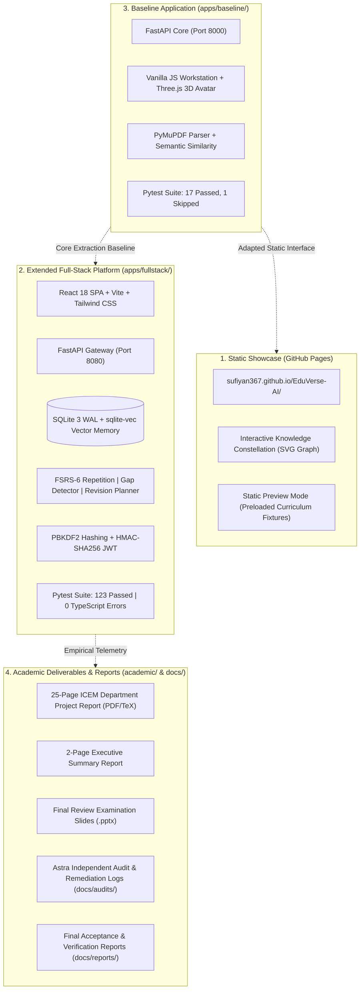

# EduVerse AI — An Animated Virtual Tutor for Personalized Learning

[](LICENSE)
[](https://python.org)
[](https://fastapi.tiangolo.com)
[](apps/fullstack/frontend/)
[](https://pymupdf.readthedocs.io/)
[](https://threejs.org)
[](https://sufiyan367.github.io/EduVerse-AI/)
[](apps/fullstack/tests/)
[](apps/fullstack/tests/test_remediation_suite.py)
[](apps/baseline/tests/)

> **Live Static Showcase (GitHub Pages):** [https://sufiyan367.github.io/EduVerse-AI/](https://sufiyan367.github.io/EduVerse-AI/)  
> **Deployment Workflow:** [`.github/workflows/deploy-pages.yml`](.github/workflows/deploy-pages.yml)  
> **Local Full-Stack Evaluation Gateway:** [http://127.0.0.1:8080](http://127.0.0.1:8080) (FastAPI + React 18 SPA)  
> **Local Baseline Application:** [http://127.0.0.1:8000](http://127.0.0.1:8000) (FastAPI + Three.js WebGL Workstation)  

---

### Academic Affiliation & Project Credits
- **Institution:** Indira College of Engineering and Management (ICEM), Parandwadi, Pune
- **Department:** Artificial Intelligence & Data Science
- **Affiliation:** Autonomous Institute Affiliated to Savitribai Phule Pune University (SPPU)
- **Academic Year:** 2026–2027
- **Course:** B.Tech Mini-Project / AI-Powered Educational Technology
- **Project Team:**
  - Aryan Shinde (AI-01)
  - Huzaifa Sheikh (AI-02)
  - Sufiyan Surve (AI-03)
- **Project Mentor:** Prof. Monika Patil, Assistant Professor, Department of AI & DS, ICEM Pune

---

## 1. Project Purpose & Architecture

**EduVerse AI** is an interactive, evidence-grounded virtual tutor designed to resolve student doubt paralysis and counteract the Ebbinghaus forgetting curve. When studying dense engineering syllabi, students often face two extremes: passively skimming hundred-page slide decks or querying unconstrained commercial chatbots that risk hallucinations and syllabus misalignment.

EduVerse AI enforces **strict syllabus grounding and active recall**:
$$\text{Syllabus PDF} \longrightarrow \text{PyMuPDF Fast Extraction} \longrightarrow \text{Dense Vector Memory (sqlite-vec)} \longrightarrow \text{Grounded Tutoring with Bracketed Citations} \longrightarrow \text{Active Recall Quizzes} \longrightarrow \text{FSRS Spaced Repetition}$$



---

## 2. Consolidated Repository Layout

```text
EduVerse-AI-Complete/
├── README.md                          # Master documentation & quickstart
├── LICENSE                            # MIT License
├── THIRD_PARTY_NOTICES.md             # Third-party dependencies & attributions
├── .gitignore                         # Comprehensive ignore rules
├── .env.example                       # Safe environment variable template
├── requirements.txt                   # Baseline Python dependencies
├── apps/
│   ├── baseline/                      # Baseline FastAPI application
│   │   ├── backend/                   # FastAPI main.py, config, schemas, routers
│   │   ├── frontend/                  # Vanilla JS workstation & Three.js canvas
│   │   └── tests/                     # Baseline pytest regression suite (18 tests)
│   └── fullstack/                     # Extended full-stack web platform
│       ├── backend/                   # FastAPI quicklearn package & database models
│       ├── frontend/                  # React 18, Vite, TypeScript, Tailwind CSS
│       ├── tests/                     # Full regression test suite (123 tests)
│       └── scripts/                   # Verification runners & startup scripts
├── deployments/
│   └── github-pages/                  # Static showcase assets for GitHub Pages
├── academic/
│   ├── report/                        # 25-page LaTeX report, 2-page brief, TeX sources
│   ├── presentations/                 # Review presentation decks (.pptx)
│   └── assets/                        # High-resolution slide renders & diagrams
├── docs/
│   ├── architecture/                  # Architectural schematics & data flows
│   ├── audits/                        # External Astra security audits & remediation logs
│   ├── deployment/                    # Detailed GitHub Pages & local setup guides
│   └── reports/                       # Formal acceptance & verification reports
└── .github/
    ├── workflows/
    │   ├── deploy-pages.yml           # Automated GitHub Pages static deployment
    │   └── ci.yml                     # Continuous integration workflow
    ├── ISSUE_TEMPLATE/                # Bug report & feature request templates
    └── PULL_REQUEST_TEMPLATE.md       # Standard pull request checklist
```

---

## 3. Running the Applications

### Option A: Extended Full-Stack Web Platform (`apps/fullstack/`)
*Recommended for local evaluation and college grading.*

```powershell
# 1. Navigate to fullstack directory
cd apps\fullstack

# 2. Launch using the automated PowerShell script
.\run_eduverse.ps1
```
- Starts the FastAPI daemon on **`http://127.0.0.1:8080`** and opens your default browser.
- **One-Click Demo Login:** Click **"Demo Student"** (`student@eduverse.ai` / `demo123`).
- **Graceful Shutdown:**
  ```powershell
  .\stop_eduverse.ps1
  ```

---

### Option B: Baseline Application (`apps/baseline/`)
*Lightweight baseline service featuring the Three.js 3D WebGL avatar.*

```powershell
# 1. Navigate to baseline directory
cd apps\baseline

# 2. Install baseline dependencies
pip install -r requirements.txt

# 3. Launch with Uvicorn
python -m uvicorn backend.main:app --host 127.0.0.1 --port 8000 --reload
```
- Open **`http://127.0.0.1:8000`** in your browser.
- Interactive OpenAPI docs: **`http://127.0.0.1:8000/docs`**.

---

### Option C: GitHub Pages Static Showcase
*Online static showcase without local installation.*

- Live deployment: **`https://sufiyan367.github.io/EduVerse-AI/`**
- Features supported without backend: Interactive Knowledge Constellation (SVG concept graph), curriculum topic inspector, accessible list view, and sample 4-option practice questions.
- Features requiring local backend: Custom PDF ingestion, real-time Gemini/Ollama AI inference, and database persistence.
- Complete deployment walkthrough: [`docs/deployment/GITHUB_PAGES.md`](docs/deployment/GITHUB_PAGES.md).

---

## 4. Automated Testing & Verification Evidence

### 4.1 Full-Stack Test Suite (123 Tests Passed)
```powershell
cd apps\fullstack
python -m pytest tests -v
```
```text
======================== 123 passed, 1 warning in 143.57s ========================
```
- `tests/test_api.py`: 34 passed (Routes, payloads, status codes)
- `tests/test_remediation_suite.py`: 8 passed (Astra P0/P1 security hardening)
- `tests/test_user_isolation.py`: 3 passed (Alice/Bob multi-user clean-room isolation)
- `tests/test_local_providers.py`: 20 passed (Ollama, LM Studio, Mock adapters)
- `tests/test_providers.py`: 28 passed (Rate limit, quota, and error translations)
- `tests/test_learning_workflows.py`: 6 passed (FSRS, RAG, concept extraction)
- `tests/test_jobs.py`: 17 passed (Background job worker pool)
- `tests/test_eduverse_features.py`: 7 passed (Auth, gap detection, revision planner)

### 4.2 13-Step End-to-End Workflow Verification
```powershell
cd apps\fullstack
python tests/verify_full_demo_workflow.py
```
```text
======================================================================
ALL 13 END-TO-END WORKFLOW STEPS PASSED WITH 100% SUCCESS!
======================================================================
```

### 4.3 Baseline Engine Test Suite (17 Passed, 1 Skipped)
```powershell
cd apps\baseline
python -m pytest tests -v
```
```text
======================= 17 passed, 1 skipped in 46.95s ========================
```

### 4.4 Frontend TypeScript & Build Verification
```powershell
cd apps\fullstack\frontend
npm run typecheck    # tsc --noEmit -> 0 errors (Exit code 0)
npm run build        # vite build -> 4,223 modules compiled cleanly to dist/
```

---

## 5. Security & Integrity Audit Remediation

All 6 defects identified during external Astra evaluation have been reproduced, fixed, and verified with dedicated regression tests:

| Finding | Severity | Root Cause | Implemented Remedy | Regression Test | Status |
| :--- | :---: | :--- | :--- | :--- | :---: |
| **P0-1: Anonymous Access & Ownership Bypass** | Critical | Missing token verification on protected endpoints | Mandatory `get_current_user` dependency; strict server-side owner filtering | `test_p0_1_cross_user_isolation_forbidden` | **VERIFIED** |
| **P0-2: Insecure Default Token Signing Key** | High | Static fallback JWT secret | Required high-entropy secret; strict rejection of insecure defaults | `test_p0_2_jwt_signing_key_security` | **VERIFIED** |
| **P0-3: Duplicate Quiz Submissions Inflate Mastery** | High | Re-grading on repeated identical attempts | Idempotent attempt deduplication and historical stat preservation | `test_p0_3_quiz_submission_idempotency` | **VERIFIED** |
| **P0-4: Flashcard Undo Leaves Concept Mastery Mutated** | High | Unatomic rollbacks during card undo | Atomic state machine restoration of difficulty, stability, and mastery | `test_p0_4_flashcard_undo_restores_prior_state` | **VERIFIED** |
| **P0-5: Knowledge Gap Detector Reports Inaccurate Gaps** | Medium | Fabricated evidence strings | Strict linkage of gaps to actual failed question answers & syllabus topics | `test_p0_5_gap_detector_accurate_quiz_evidence` | **VERIFIED** |
| **P0-6: Revision Planner Lacks Multi-User Persistence** | Medium | Volatile in-memory sessions | Persistent SQLite storage with user-scoped isolation and status tracking | `test_p0_6_revision_planner_database_persistence` | **VERIFIED** |

Audit documentation:
- [`docs/audits/ASTRA_INDEPENDENT_AUDIT.md`](docs/audits/ASTRA_INDEPENDENT_AUDIT.md): Original external audit report.
- [`docs/audits/ASTRA_REMEDIATION_BACKLOG.md`](docs/audits/ASTRA_REMEDIATION_BACKLOG.md): Step-by-step remediation log.
- [`docs/reports/FINAL_ACCEPTANCE_REPORT.md`](docs/reports/FINAL_ACCEPTANCE_REPORT.md): Comprehensive acceptance report.

---

## 6. Academic Deliverables & Report Compilation

The project deliverables include the 25-page academic project report conforming strictly to ICEM AI&DS department formatting:
- **Project Report:** [`academic/report/EduVerse_AI_Project_Report.pdf`](academic/report/EduVerse_AI_Project_Report.pdf) (Strictly 25 pages compiled with Tectonic).
- **Executive Summary:** [`academic/report/EduVerse_AI_Two_Page_Report.pdf`](academic/report/EduVerse_AI_Two_Page_Report.pdf) (Condensed 2-page brief).
- **Viva Presentation Deck:** [`academic/presentations/EduVerse_AI_Review_2_FINAL.pptx`](academic/presentations/EduVerse_AI_Review_2_FINAL.pptx).
- **Page Count Verification:**
  ```powershell
  python -c "import pymupdf; doc = pymupdf.open(r'academic/report/EduVerse_AI_Project_Report.pdf'); print(f'Total Pages: {len(doc)} (Target: 25)')"
  ```
  **Output:** `Total Pages: 25 (Target: 25)`

---

## 7. Known Limitations & Educational Scope

- **Machine-Readable PDFs:** Text extraction is optimized for digital PDFs; scanned photocopies require external OCR pre-processing.
- **Single-Pass File Size:** Recommended file size limit is $25\text{ MB}$ per document.
- **GitHub Pages Static Scope:** GitHub Pages runs client-side preview mode only; live AI responses, custom PDF processing, and user persistence require running the local Python backend.
- **Local LLM Requirements:** High-capacity local models (7B+ parameters via Ollama) require a discrete GPU with at least 8 GB VRAM.

---

## 8. License & Attribution

- **License:** Open-source under the [MIT License](LICENSE) — Copyright (c) 2026 Aryan Shinde, Huzaifa Sheikh, Sufiyan Surve (ICEM Pune).
- **Third-Party Component Notices:** Detailed in [THIRD_PARTY_NOTICES.md](THIRD_PARTY_NOTICES.md).
