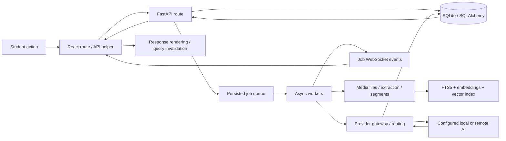

# EduVerse AI — independent audit

**Assessment: NOT READY for the requested college-demo acceptance gate.**

Audit date: 23 October 2026, Asia/Calcutta. This is an independent review of current local code, not an endorsement of earlier acceptance reports. Critical authorization defects and reproducible learning-data corruption remain. Successful mock-provider tests do not establish real inference quality, browser correctness, or multi-user isolation.

## 1. Scope, provenance and preservation

The supplied workspace contains several applications. The primary audit target is **`EduVerse_Web_Demo/`**, because it implements the mission's authentication, flashcards, FSRS, knowledge gaps and revision planner. Findings below use paths relative to that directory unless explicitly labeled legacy.

| Checkout | Observed state |
|---|---|
| Workspace root `S:/SY/SEM 3/MP` | Branch `main`; initial HEAD `9362a5c` (hologram/topic-chip removal); origin `https://github.com/Sufiyan367/EduVerse-AI.git`; modified backend/frontend/tests/report and untracked applications/artifacts |
| `EduVerse_Web_Demo` | Separate Git repository; branch `main`; HEAD `9159a6a1912b77ab80b9233777dfd45b2c2c10ea`; origin still `https://github.com/artbyjazi/quicklearn`; 15 tracked files modified, plus untracked isolation migration/test and reports |
| `EduVerse_Foundation_PoC/upstream_quicklearn` | Older foundation checkout; referenced by the web demo virtual environment's editable installation |
| `EduVerse-AI` | Additional legacy application copy; not assumed to be the active demo |

Root HEAD advanced to `18e1cc95a7425b65d8c684b5277fc7c0aac605d0` during the audit, indicating concurrent work. This audit made **no commits, pushes, merges, deployment changes, application fixes, or real-database changes**. Application Python/TypeScript/CSS hashes in the primary target were unchanged between snapshot and subsequent comparison (0 changed files). A Git commit is not a complete identifier for these uncommitted changes; use the retained snapshot and hash manifest.

Primary backend code and tests were copied to a separate audit directory before execution. Tests use synthetic users and disposable databases. Source files, reports, PDFs, presentations and production data were not overwritten. No real credentials were read from data/settings or copied into this report. No live provider calls were intentionally made.

Evidence directory:
`C:/Users/sufiy/.codex/visualizations/2026/10/22/01a1642f-ad56-77b2-89e2-fce9160e260c/astra-audit/`

Contains `snapshot/backend/`, `initial-hashes.json`, independent probe code, and audit evidence. Added tests live only in the snapshot; the other agent's application/test files are untouched. This report and the companion backlog are the intentional workspace deliverables.

Evidence terminology:

- **Reproduced:** independently executed on the isolated current-code snapshot.
- **Verified code:** directly inspected behavior/control flow, without claiming an executed exploit or UI observation.
- **Risk:** plausible but still requires a targeted test.
- **Historical claim:** another report's statement, not current evidence.
- **Blocked / not tested:** explicitly distinguished in the acceptance matrix.

## 2. Verified architecture and dependency map

### Web demo

Frontend: React **18** in `frontend/package.json` (not React 19 as an earlier report states), TypeScript, Vite, TanStack Router/Query, Zustand, Tailwind, Radix components, Tiptap editor, KaTeX/Mermaid and media components. Entry: `frontend/src/main.tsx`; route definitions: `frontend/src/router.tsx`; API client: `frontend/src/lib/api.ts`; realtime updates: `frontend/src/lib/ws.ts`.

Routes: dashboard, library, source detail, flashcard review, quiz, chat, knowledge gaps, revision, podcasts, recording and settings. UI login gating is not a substitute for backend authorization. Bearer tokens are read from localStorage for the common fetch helper; the separate XHR upload path omits that header.

Backend: `backend/quicklearn/main.py:create_app`; FastAPI serves `/api/v1`, WebSockets, compiled static assets and SPA fallback. Lifespan initializes migrations and starts a database-backed worker pool; shutdown stops the pool and closes providers. Development CORS is optional and localhost-scoped.

Persistence: SQLAlchemy + SQLite with WAL, foreign keys, busy timeout and Alembic migrations; FTS5 and sqlite-vec virtual structures initialized separately. Tables include users; folders/tags; sources; transcripts/segments; notes/blocks; concepts; cards/reviews; quiz items/sessions/attempts; chats/messages; jobs; provider settings/call telemetry; uploads; revision sessions/activity. Sources and notes gained nullable user IDs in an **untracked** migration. Cards and attempts inherit no enforced user boundary through their current routes. Shared concept mastery is stored on the concept row.

Ingestion: uploaded media stays under configured `data/media/<source_id>/original.<ext>`, not in PDF blob rows. Single upload streams to disk with a 2 GiB ceiling. Acquisition dispatches PDF/text/office/web/audio/video/image handlers; jobs perform extraction/segmentation/filtering and study artifact generation/indexing. Resumable upload and recordings are additional surfaces requiring ownership/limit tests. Filesystem, DB and indexes must remain consistent across failures.

AI: registry routes fast/standard/deep tasks to configured providers; supported adapters include OpenAI, Anthropic, Google, Groq, OpenRouter, Ollama, LM Studio and explicit mocks. Embeddings support FastEmbed/OpenAI/Ollama/mock. Settings precedence is environment → database → defaults; fresh defaults do not select a real LLM. API keys are encrypted with a machine-local `.secret`; token signing incorrectly uses a separate hardcoded fallback. Gateway validates structured outputs and records call metadata. Provider HTTP code has connect/read/write timeouts and translated errors; this does not guarantee every caller preserves learning state on failure.

Retrieval: document segments → embeddings + FTS5 → vector/keyword rankings → reciprocal-rank fusion → optional LLM rerank → excerpts → answer generation. Citation markers are checked against supplied segment IDs, but unsupported answer text can survive. Retrieval scope is source/folder/global, without an authenticated owner dimension.

Learning: FSRS-6 wrapper maintains per-card scheduling and reviews. Mastery uses `m += (1-m)*0.3` on correct answers and `m *= 0.5` on incorrect answers (partial scores modify these rules). Gap detection aggregates quiz attempts and lapsed cards. Revision planning combines gaps/due cards/recent sources into rule-based recommendations, not an independently validated intelligent scheduler. No source-backed prerequisite graph was verified in this web demo; concepts alone do not establish Knowledge Constellation relationships.



Concrete flows:

1. Upload: Library → XHR multipart upload → source row + media file → ingest job → extraction/segments → concepts/notes/cards/quiz/index → WebSocket/polling → source view. Missing upload bearer token currently breaks ownership at the first boundary.
2. Question: chat route → stored user message → scope resolution → hybrid retrieval/rerank → configured model → citation-marker filtering → stored assistant message → REST/WebSocket rendering. Authorization must constrain every stage, including citation resolution.
3. Quiz: create session → choose/generate item → increment served → submit response → deterministic MCQ/cloze or AI free-response grade → attempt insert → separate mastery transaction → results/gap/dashboard. Retries and failed grading currently corrupt this path.
4. Review: due cards → rating → FSRS scheduling + review row → separate mastery update. Undo restores card state and removes review, but leaves mastery modified.

### Legacy root application

FastAPI + PyMuPDF + SQLite + vanilla frontend, now split into JS/CSS modules. Routes cover documents/sample/passages/concepts, tutor/simplification, quiz generation/evaluation/history. Root storage has documents/quizzes/aggregate evaluations/concepts. This is a different contract and data model from `/api/v1` in the web demo. Root quiz generation still exposes its answer key and repeated evaluations create new rows; no user isolation was verified there. Do not attribute the web demo's FSRS/RAG/authentication to this application.

Academic artifacts remain in `EduVerse_AI_Project_Report`, root presentation files, and foundation reports. They were inventoried, not regenerated or substantively fact-checked. Align future academic claims with the chosen application and verified capabilities.

## 3. Ranked findings

### A01 — Critical / P0 — Anonymous and invalid-token ownership bypass

**Reproduced.** `backend/quicklearn/api/sources.py:37–39` rejects mismatched owners only if a user exists. `get_optional_user` returns `None` for absent/invalid tokens. Notes have the same conditional guard (`api/notes.py:30`).

Synthetic steps: seed Alice-owned source and note; request source with Bob's valid bearer token; repeat without header and with `Bearer invalid`; PATCH source without header.

Observed: Bob **403**; anonymous source **200**; invalid-token source **200**; anonymous note **200**; anonymous source edit **200**. This is an authentication bypass, not merely a missing privacy banner. A user can evade the new ownership check by dropping the token.

Fix: require authentication for private resources; reject invalid credentials rather than treating them as public mode; centrally enforce ownership on reads/writes/media/jobs/derived content. Define explicit demo/public access separately. Add absent/invalid/expired token tests alongside two-user tests.

### A02 — Critical / P0 — Public administrative and learning routes; aggregate cross-user leakage

**Reproduced for cards, settings and dashboard; verified code for broader routes.** `api/cards.py`, `api/quiz.py`, `api/chat.py`, `api/system.py`, `api/library.py` have unguarded routes. Dashboard accepts optional user but queries all sources/cards/attempts. Knowledge gaps and recommendations aggregate globally.

Observed: Bob read Alice's synthetic card; anonymous card PATCH **200**; anonymous settings PATCH **200**; Bob dashboard reported Alice's source. Source IDs/citation IDs are not safe authorization tokens. WebSockets also accept connections without owner checks.

Impact: cross-user disclosure/tampering, scheduler/mastery corruption, shared provider configuration takeover and unauthorized AI usage. Settings masking does not prevent unauthorized settings mutation.

Fix: enforce authentication + ownership on all resource families, retrieval, exports and WebSockets; reserve provider settings for an administrative principal. Owner-scope jobs, uploads, chats, revisions, search and aggregates. Test direct IDs, global queries and derived resource access. Do not declare complete isolation based on three endpoints.

### A03 — Critical / P0 — Predictable signing fallback and optional token expiry

**Reproduced on default configuration.** `auth.py:29` uses a static fallback despite its comment promising persisted randomness; `auth.py:102` checks expiry only when truthy.

In an isolated database, a token signed independently using the fallback found in source, containing a synthetic Alice subject but **no `exp`**, was accepted by `/api/v1/auth/me`: **200**, returning the synthetic target user. No live token or secret is included here.

Fix: require a high-entropy persisted signing secret or fail startup when absent; validate required expiry/issued-at/algorithm and numeric subject; rotate affected tokens. Seeded demo credentials must be opt-in and unavailable in a public deployment. Add default-secret, missing-expiry and malformed-subject tests. Current environment overrides elsewhere were not inspected, so this reproduction establishes the default vulnerability, not the configuration of every deployment.

### A04 — High / P0 — Browser uploads omit bearer authentication

**Verified frontend code + reproduced backend behavior.** `frontend/src/lib/api.ts:115–131` creates XHR without `setRequestHeader('Authorization', ...)`, while normal fetch requests attach it.

Synthetic upload using that headerless request shape returned **200** and persisted `Source.user_id = null`. This is not a browser-run result, but the request construction and backend result are independently established. The new ownership migration also leaves pre-existing sources/notes ownerless without an explicit assignment policy.

Impact: logged-in uploads become shared/unowned; tightening backend auth without repairing this frontend path will break upload.

Fix: authenticated upload helper; audit recording/export/media transports too; reject anonymous private uploads; explicitly migrate/quarantine legacy unowned rows. Regression: browser upload as Alice must persist Alice's ID and be inaccessible to Bob/anonymous users.

### A05 — High / P0 — Quiz attempts are replayable, out-of-scope and accepted after completion

**Reproduced.** `api/quiz.py:184–220` loads any item, inserts an attempt, then updates mastery separately; it does not enforce a served-item identity, source membership, active session or idempotency.

Observed: submitting the same correct item twice and once after viewing results returned **200/200/200**, persisted **3 attempts**, and changed mastery **0.3 → 0.51 → 0.657**. Another source's unserved item submitted to this session was accepted (**200**, mastery **0.3**).

Impact: network retries inflate demonstrated learning; arbitrary questions contaminate sessions and source progress. Attempt insertion and mastery mutation are separate transactions, adding a consistency risk if the latter fails (not fault-injected here).

Fix: persisted served-item identity + attempt idempotency key/uniqueness; validate ownership, scope and active status before grading; atomically store evaluation and mastery event. Closed sessions reject new answers. Replays return the original result without another update.

### A06 — High / P0 — Provider grading failure reduces student mastery

**Reproduced by fault injection.** `pipeline/generate/quiz.py:300` catches free-response provider exceptions and returns score 0/incorrect with an “ungraded” message; the answer route then records that as real evidence.

Starting mastery **0.8**, a simulated provider outage produced HTTP **200**, score **0.0**, `is_correct=false`, mastery **0.4**. The synthetic outage is not evidence of an actual provider outage; it proves handling of one.

Fix: explicit pending/ungraded status excluded from accuracy, gaps and mastery; retain the student's response; retry grading idempotently. Provider failure is never evidence that a student answered incorrectly.

### A07 — High / P1 — Retry of next-question request consumes the quiz

**Reproduced.** `api/quiz.py:113,146`: GET next increments `served`; limit is checked against served count, not completed answers.

One-question test session: first GET returns a question; repeating GET before any answer returns `done=true`, reason **“Reached the end of the quiz.”** Frontend query refetch/navigation/retry can therefore skip an unanswered item. Browser trigger not executed; API semantics are reproduced.

Fix: persist pending question and return it until submitted; advance explicitly after an accepted answer. Test refresh, refetch and concurrent next requests.

### A08 — High / P0 — Undo restores FSRS card but leaves mastery changed

**Reproduced.** `study/review.py:129–172` stores card state and applies mastery separately. Undo restores only card fields and deletes the review.

Rate synthetic card Good, then undo: both responses **200**; repetitions restored to **0**, mastery remained **0.3** instead of initial **0.0**.

Fix: reversible learning event and atomic transaction, restoring/recomputing mastery with concurrency-aware event ordering. Test review→undo and repeated review/undo cycles. Do not simply overwrite mastery with an old value if later learning events exist.

### A09 — High / P1 — Citation filtering does not enforce supported answers

**Reproduced pure-function behavior.** `api/chat.py:validate_answer` removes invented citation markers but leaves their claims. A synthetic irrelevant answer citing `[999]`, with one unrelated valid excerpt, retained its unsupported assertion and returned an empty citation list. This does **not** claim an actual model emitted that assertion.

`rag/retrieve.py:224` also falls back to ranked excerpts even when reranker scores every candidate irrelevant. Missing citations, valid-ID-but-unrelated claims and prompt injection are not fully checked by marker validation.

Fix: explicit unsupported/partial/supported contract; allow empty retrieval after irrelevance filtering; reject or regenerate uncited material claims; test citation-to-claim support, scope, long documents and unsupported queries with real providers. Valid segment IDs establish provenance, not entailment.

### A10 — Medium / P2 — Conflicting learning metrics and premature “MASTERED” classification

**Reproduced and verified code.** After the first correct answer, gap status was **MASTERED** while concept mastery was **0.3**. `study/knowledge_gap.py` classifies accuracy ≥90% with no minimum sample requirement. Dashboard labels per-attempt pass percentage as quizzes passed; card mastery allows `reps >= 3` without checking recent lapses despite its comment.

These metrics derive from actual rows, not hardcoded sample progress, but the semantics are misleading and contaminated by A02/A05/A06/A08. Revision planner computes `has_attempts` but never uses it to gate its initial-study recommendation.

Fix: distinguish accuracy, evidence count and modeled mastery; minimum evidence threshold; per-session pass metric; include lapse state; actually query attempts when recommending initial study. Do not call these measures calibrated learning mastery.

### A11 — High / P1 — Shutdown/launcher claims exceed implemented process guarantees

**Verified code; deliberately not run against the active demo.** `stop_eduverse.ps1:45,64` uses `Stop-Process -Force`, yet reports clean/graceful shutdown. Matching any command/executable containing `quicklearn` or `eduverse`, plus a hardcoded 8080 fallback, does not establish this checkout owns the process. Multiple EduVerse copies exist on this machine.

Fix: record and verify exact executable, checkout, data directory, port and process start identity; request graceful shutdown and await worker/provider cleanup; use bounded forced fallback only for the specifically owned process. Test queued/in-flight jobs and alternative ports in an isolated process. Do not run current stop script while another agent owns a demo instance.

### A12 — Low / P3 — Documentation and build provenance drift

**Verified.** Earlier report says React 19 (manifest is React 18), clean working tree (15 modified tracked files observed), strict user isolation (A01/A02), and graceful shutdown (A11). The web demo origin is still the foundation's repository. CI backend mypy is explicitly non-blocking. No remote CI results were checked.

Fix: record exact commit + dirty-tree hash, installed versions, commands, provider mode, timestamp and evidence; explain foundation attribution and intended remote. Do not change remotes or publish without authorization.

## 4. Additional security/reliability risks still requiring tests

- URL acquisition validates HTTP(S) syntax but no private-network/redirect destination restriction was found in the inspected web-fetch path; provider base URLs are user-configurable. SSRF/credential-forwarding risk needs controlled local-only testing, not requests to sensitive host services.
- Anki export uses `deck_name` in a destination path (`api/cards.py:132`) without visible filename sanitization. Path containment/overwrite risk: test only inside an isolated writable directory. No overwrite exploit was run.
- Upload/chunk APIs need quotas, request limits, expiry and interrupted-upload cleanup; a 2 GiB cap alone does not bound abuse or parser CPU. Large/malformed/zip-bomb/decompression tests were not run.
- No login/API rate limiter was found in inspected routes. No load test or denial-of-service attempt was performed.
- Reprocessing/deleting/regenerating while jobs run, competing quiz submissions, DB lock/recovery and migration of existing data require separate fault injection.
- Keys are masked/encrypted in settings, but unexpected exception text is returned by the global handler, and provider errors enter telemetry. Secret-bearing error redaction was not exhaustively tested.
- Frontend quiz session ID is component state, so reload restoration is not established. Empty/error query distinctions, dialog focus, mobile overflow, console errors and screen-reader behavior need browser verification.
- Static assets may not correspond to modified frontend sources until rebuilt. Typechecking alone does not establish served-bundle freshness.
- No fresh dependency-vulnerability database lookup, package audit, network CI verification, or live-provider availability/model validation was performed; no “dependency-safe” claim is made.

## 5. Blind spots in existing tests and previous claims

`test_user_isolation.py` covers Alice/Bob sources, notes and revision sessions with **valid tokens**. It omits missing/invalid tokens, cards, settings, chat, citations, global retrieval/search, dashboard, jobs and WebSockets. Its client does not enter the lifespan context, so it is not a startup test.

The test named `test_document_ingestion_and_segmentation` in `test_learning_workflows.py` manually inserts a source/segment; it does not itself parse a PDF. Other API tests do exercise pipelines, but fixture/mock mode must remain explicit. Existence of concept rows is not proof of correct extraction. Citation-ID validity is not proof that answers follow from cited text.

Existing fixture settings route AI/STT/TTS/embeddings to mocks. Those tests establish plumbing and controlled error behavior, not real provider reasoning, embedding relevance, latency or source fidelity. A “115 passed” historical summary was not reused as a current result.

The audit's defect probes assert the **observed faulty behavior** to reproduce it. Their passing result means reproduction succeeded; it must not be reported as application acceptance. Convert them to desired-behavior regression tests when fixing.

## 6. End-to-end acceptance matrix

PASS requires the listed scope and evidence; a unit/API PASS never substitutes for full browser E2E. FAIL means a reproduced defect or code-proven acceptance violation. BLOCKED means the current gate cannot be completed safely/meaningfully until its dependency is resolved. NOT TESTED means simply not executed in this audit.

| Case | Preconditions and actions | Expected result / required evidence | Severity on failure | Current status |
|---|---|---|---|---|
| A. Fresh DB initialization | Empty isolated data directory; run init/migrations | Exit 0; schema initialized; repeat safe | High | PASS for isolated initialization; full launcher separate |
| B. Clean process startup | Chosen checkout, isolated port/data, built frontend | Ready endpoint + UI + worker log; exact import path | High | NOT TESTED end-to-end |
| C. Login/demo access | Synthetic active/inactive users; login and `/me` | Correct login accepted; forged/expired/invalid denied | Critical | FAIL: forged no-expiry token accepted |
| D. Dashboard/navigation | Two synthetic users; visit all routes desktop/mobile | User-scoped content, no console errors, usable keyboard navigation | High | FAIL for scoping; browser navigation NOT TESTED |
| E. PDF upload/ingestion | Synthetic text PDF, authenticated browser | Correct owner, file, segments, index, completed jobs; no stale spinner | High | FAIL for upload ownership; PDF browser path NOT TESTED |
| F. Grounded answer/citations | Synthetic relevant/irrelevant docs; real configured model | Supported answer; exact permitted sources; unsupported refusal | High | FAIL contract probe; real inference NOT TESTED |
| G. Concepts/notes/cards | Ingest synthetic document; generate/edit/reopen | Content tied to correct source/user; valid references | High | BLOCKED for isolation acceptance; UI/source quality NOT TESTED |
| H. Quiz assessment | Serve item; answer; retry; submit foreign/closed item | One accepted attempt per served item; scope and state enforced | High | FAIL: replay, closed and foreign items accepted |
| I. Mastery updates | Correct/wrong/ungraded attempts and review undo | Defined rule once per valid event; outage/undo does not corrupt | High | FAIL: outage and undo corrupt mastery |
| J. FSRS scheduling | Rate/undo synthetic cards; reload | Review/card/mastery agree; due date retained | High | FAIL combined invariant; standalone scheduling not fully audited |
| K. Study planning | No attempts, weak concept, due cards, completed work | User-scoped priorities; no false mastery/initial-study claims | Medium | FAIL code review semantics/scoping; full workflow NOT TESTED |
| L. Reload/restart persistence | Record quiz/review/chat; reload browser and restart isolated server | Same records and scheduling; no duplication | High | PASS for DB source reopen only; full E2E NOT TESTED |
| M. Two-user isolation | Alice private resources; Bob/anonymous/invalid token reads+writes | Every REST/WS/search/export denied across owners | Critical | FAIL reproduced |
| N. Invalid inputs/files/config | Empty/malformed files, wrong IDs, absent provider | Bounded actionable errors, no orphan/corrupt state | High | NOT TESTED for full browser/file-abuse case; mock suite provides narrower coverage |
| O. Provider errors/rate limit/malformed output | Inject timeout/429/bad JSON/outage | Retryable pending outcome; no penalty or fake answer | High | FAIL grading outage; full provider matrix NOT TESTED |
| P. Shutdown/restart | Only audit-owned server, queued jobs and pending writes | Graceful stop logged, port free, restart recovery | High | BLOCKED for claimed script guarantee; script uses force; not invoked |
| Q. Final console/log review | Built current frontend and isolated full run | No unexpected JS/backend errors; logs scrubbed | High | NOT TESTED |

Mock integration successes recorded below are narrower evidence than these full-journey rows.

## 7. Verification commands and observed results

Working directory for backend commands: `<evidence>/snapshot/backend`. Interpreter: `S:/SY/SEM 3/MP/EduVerse_Web_Demo/backend/.venv/Scripts/python.exe`.

1. `git status --short`, `git branch --show-current`, `git log -5 --oneline`, `git remote -v`: observed checkout states in section 1. No reset/clean/fetch/push performed.
2. `python --version`: **Python 3.11.9**.
3. From workspace root, `python -c "import quicklearn; print(quicklearn.__file__)"`: resolved to **foundation checkout**. From snapshot backend cwd, same probe resolved to **snapshot/backend/quicklearn/__init__.py**. Explicit cwd/import provenance is mandatory; editable environment can otherwise audit a different copy.
4. Frontend `node node_modules/typescript/bin/tsc --noEmit`: **exit 0, no diagnostics**, run against current web-demo frontend. Does not build or visually verify UI.
5. Sandbox pytest stalled. A 25-second faulthandler watchdog showed `socket.socketpair → accept` during asyncio event-loop creation in TestClient; **exit 1** from watchdog. This was an execution-environment limitation, not an application assertion failure. The stalled audit sessions were interrupted; no demo server was stopped.
6. Isolated `init_database(Config(data_dir=<audit diagnostic directory>))`: **BEFORE INIT / INIT OK**, **exit 0**. No original database accessed.
7. Outside-sandbox isolated `python -u -m pytest tests/test_astra_independent.py -q -s -p no:cacheprovider` (initial eight probes): **8 passed, 1 warning in 17.86s**, exit 0. Reproductions: A01–A06, A09 and source persistence reopen. One warning: Starlette TestClient/httpx deprecation.
8. Additional `python -u -m pytest tests/test_astra_independent.py -q -s -p no:cacheprovider -k 'review_undo or next_request or outside_session'`: **3 passed, 8 deselected, 1 warning in 10.86s**, exit 0. Reproduced A07, A08 and the scope component of A05.
9. Baseline suite: `python -u -m pytest -q -p no:cacheprovider --ignore=tests/test_astra_independent.py`: **115 passed, 1 warning in 136.50s (0:02:16)**, exit 0. This is a fresh execution of the snapshot's existing tests, with mock-provider fixtures. The warning is the same TestClient/httpx deprecation. This confirms existing mock API/pipeline, provider-adapter and unit tests passed; it does not invalidate the independently reproduced defects.
10. Follow-up initialization/settings diagnostic: **DB READY / SETTINGS READY**, exit 0. This further distinguishes the sandbox event-loop problem from database/settings startup.

### Observed probe evidence excerpt

The following values are transcribed from the actual tool output, not invented acceptance results. Runnable reproduction source is `<evidence>/snapshot/backend/tests/test_astra_independent.py`.

```text
ownership-bypass: Bob=403 anonymous=200 invalid_token=200 note=200 anonymous_edit=200
unscoped-routes: Bob_reads_Alice_card=true anonymous_card_edit=200 anonymous_settings_write=200 Bob_total_sources=1
upload-owner: status=200 owner=null
duplicate-attempt: statuses=[200,200,200] attempts=3 mastery=[0.3,0.51,0.657] first_answer_gap_status=MASTERED
grading-outage: status=200 score=0.0 is_correct=false mastery=0.4
default-signing-key: forged_token_without_expiry_status=200 impersonated_synthetic_user=true
citation-fail-open: unsupported_claim_retained=true citations=[]
database-reopen: source_preserved=true
review-undo: review=200 undo=200 mastery_after_undo=0.3 reps_after_undo=0
next-retry: first_done=false retry_done=true reason="Reached the end of the quiz."
outside-session-scope: status=200 mastery=0.3
```

Of eleven independent probes, ten reproduce defective behavior and one verifies narrow database-reopen persistence. Neither the probe count nor the 115-test suite is a full E2E acceptance score.

No current browser screenshots, live-AI outputs, external vulnerability scan, cold process restart, or production health result is claimed. Direct fixture-seeded tests do not prove PDF ingestion or browser login.

## 8. Remediation order and coordination

See [ASTRA_REMEDIATION_BACKLOG.md](ASTRA_REMEDIATION_BACKLOG.md) for actionable priorities and exit criteria.

1. Agree on the canonical demo checkout and reserve files with the fixing agent. Keep this audit snapshot immutable for reproduction.
2. Fix authentication/owner scoping and signing defaults; repair browser transport headers and define ownership for existing rows. Re-run negative isolation matrix across every route family.
3. Fix attempt identity, session state, grading-outage semantics, atomic learning updates and review undo. Re-run synthetic invariants.
4. Enforce citation support and distinguish accuracy from mastery; then validate representative real documents/provider output.
5. Harden exact-process startup/shutdown; rebuild current frontend; run the complete browser/restart/console acceptance journey on isolated data.
6. Update academic/report claims and verify intended Git remote only after evidence is collected. Publishing remains a separate authorized action.

Coordination-sensitive files: `auth.py`, all API routers, `db/models.py`, the untracked ownership migration, ingestion/acquisition, `frontend/src/lib/api.ts`, Quiz/Review/Chat routes, launcher/stop scripts and existing reports. The other agent already has edits in source/note/revision authorization and model/migration areas; do not overwrite them with a competing patch. No messages to another chat or application code changes were made by this audit.

Remaining uncertainties: active deployment configuration and secrets; served bundle freshness; real-provider grounding/latency; browser/mobile/accessibility behavior; complete existing-data migration; job cancellation/crash recovery; external dependency advisories; long-running multi-user concurrency. Known critical/high defects are sufficient for **NOT READY** even though some verification remains incomplete.
