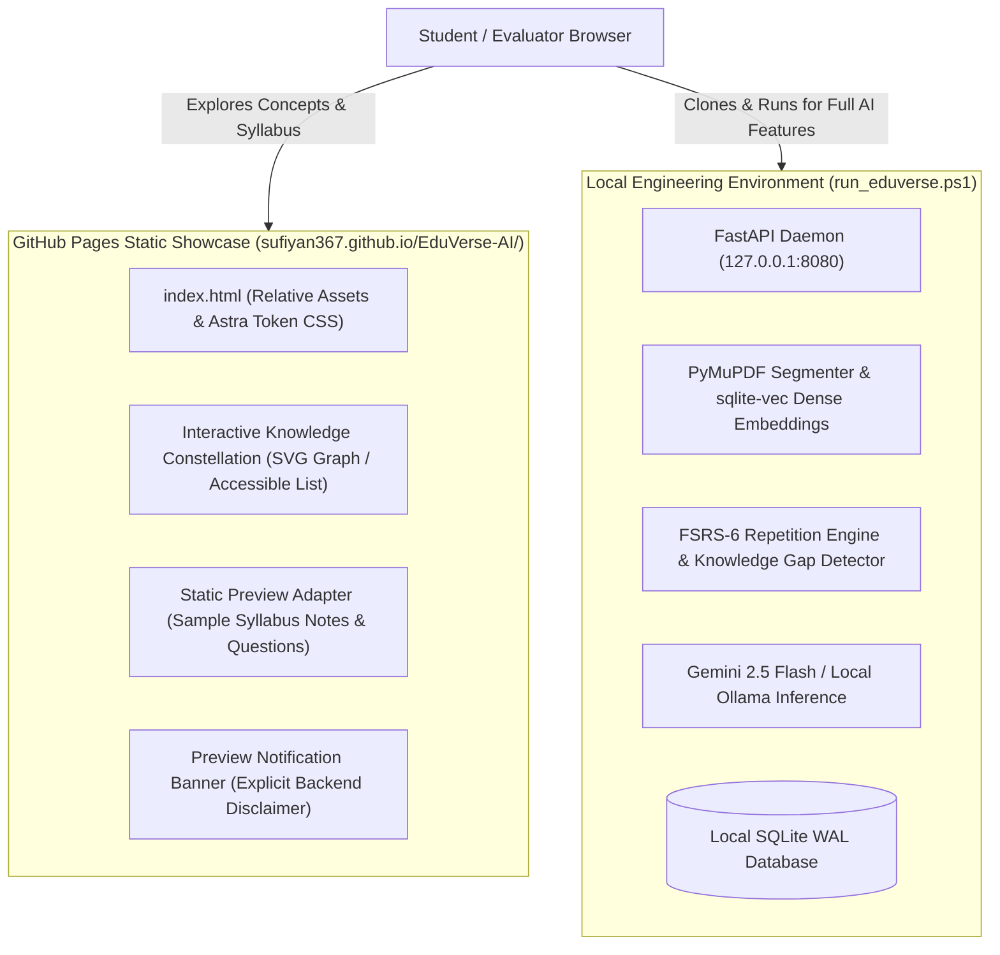

# EduVerse AI — GitHub Pages Hosting Architecture & Deployment Guide

## 1. Hosting Architecture Overview

**GitHub Pages URL:** `https://sufiyan367.github.io/EduVerse-AI/`  
**Deployment Source Directory:** `deployments/github-pages/`  
**Automated CI/CD Workflow:** [`.github/workflows/deploy-pages.yml`](../../.github/workflows/deploy-pages.yml)  

GitHub Pages is a static site hosting platform. It executes purely in the visitor's browser and does not maintain a server-side Python runtime, background job daemon, SQLite database, or secret environment variables.

To provide an honest, educational, and secure deployment, EduVerse AI uses a **Static Preview Mode** architecture:

---

## 2. Feature Parity: Static Preview vs. Full-Stack Backend

| Feature | GitHub Pages Static Showcase | Local Full-Stack Platform (`run_eduverse.ps1`) |
| :--- | :---: | :---: |
| **Interactive Knowledge Constellation** | Supported (SVG graph, node clicks, list view) | Supported (SVG graph + Three.js avatar) |
| **Curriculum Concepts & Anchors** | Supported (Pre-loaded verified ML syllabus) | Supported (Dynamic PDF extraction) |
| **Assessment Question Explorer** | Supported (Sample 4-option MCQs & explanations) | Supported (Dynamic question bank & scoring) |
| **Responsive Dark-Mode Workspace** | Supported (Astra Design System) | Supported (React 18 SPA / Vanilla Workstation) |
| **Custom PDF Upload (PyMuPDF)** | Requires Local Backend | Supported (Fast multi-page segmentation) |
| **Grounded AI Tutor Chat** | Requires Local Backend | Supported (Strict citations `[1]`, `[2]`) |
| **Spaced Repetition & Undo (FSRS-6)** | Requires Local Backend | Supported (Atomic state restoration) |
| **Knowledge Gap Detection** | Requires Local Backend | Supported (Automated remediation scheduling) |
| **Multi-User Isolation & Auth** | Requires Local Backend | Supported (PBKDF2 + High-entropy JWT) |

---

## 3. Manual Steps to Enable GitHub Pages in Repository Settings

Because GitHub Pages permissions require repository admin rights, perform these manual steps in your GitHub repository:

1. Open your web browser and go to your repository settings:  
   `https://github.com/Sufiyan367/EduVerse-AI/settings/pages`
2. Under **Build and deployment**:
   - In the **Source** dropdown menu, select **GitHub Actions**.
3. Under the **Actions** tab:
   - Verify that workflow permissions are set to **Read and write permissions** under **Settings &rarr; Actions &rarr; General &rarr; Workflow permissions**.
4. Push to branch `main` or navigate to **Actions &rarr; Deploy Static Showcase to GitHub Pages &rarr; Run workflow**.
5. Once complete, GitHub will display the live URL:  
   `https://sufiyan367.github.io/EduVerse-AI/`
