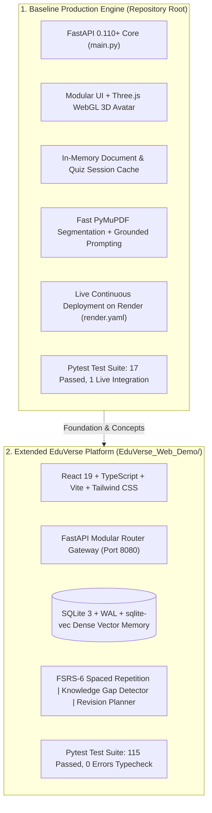

# EduVerse AI — An Animated Virtual Tutor for Personalized Learning

[](LICENSE)
[](https://python.org)
[](https://fastapi.tiangolo.com)
[](https://pymupdf.readthedocs.io/)
[](https://threejs.org)
[-brightgreen.svg)](tests/)
[](https://eduverse-ai-hpns.onrender.com)
[](https://github.com/Sufiyan367/EduVerse-AI/actions/workflows/ci.yml)

> **Live Production Service:** [https://eduverse-ai-hpns.onrender.com](https://eduverse-ai-hpns.onrender.com)  
> **Instance Plan:** Render Free Tier ($0/mo, auto-wake on request)  
> **Health Check:** [https://eduverse-ai-hpns.onrender.com/api/health](https://eduverse-ai-hpns.onrender.com/api/health)

---

### Academic Affiliation & Project Credits
- **Institution:** Indira College of Engineering and Management (ICEM), Parandwadi, Pune
- **Department:** Artificial Intelligence & Data Science
- **Affiliation:** Autonomous Institute Affiliated to Savitribai Phule Pune University (SPPU)
- **Academic Year:** 2026–2027
- **Course:** B.Tech Mini-Project / AI-Powered Educational Technology
- **Project Team:**
  - Aryan Shinde (AI-01)
  - Huzaifa Sheikh (AI-02)
  - Sufiyan Surve (AI-03)
- **Project Mentor:** Prof. Monika Patil, Assistant Professor, Department of AI & DS, ICEM Pune

---

## 1. Project Purpose & Overview

**EduVerse AI** is an interactive, evidence-grounded virtual tutor designed to eliminate the forgetting curve and resolve student doubt paralysis. In traditional self-study, students are overwhelmed by dense, fragmented PDF syllabi and turn to unconstrained public chatbots that risk hallucination and syllabus mismatch.

EduVerse AI guarantees **strict syllabus grounding**:
$$\text{Student Syllabus (PDF)} \longrightarrow \text{Fast Extraction (PyMuPDF)} \longrightarrow \text{Evidence Q\&A with Excerpt Citations} \longrightarrow \text{Active Recall Quiz} \longrightarrow \text{Instant Evaluation}$$

---

## 2. Two Synchronized Architectural Implementations

This repository maintains two complementary, verified implementations:



1. **Baseline Production Engine (Root):**
   - High-speed, dependency-minimal Python/FastAPI service deployed on Render.
   - Real-time interactive WebGL 3D avatar that changes state dynamically (`Idle`, `Thinking`, `Explaining`).
   - Verified with 17 passed local unit/API tests + 1 live cloud deployment integration test.
2. **Extended Web Platform (`EduVerse_Web_Demo/`):**
   - Dedicated standalone full-stack application for local examination demonstrations.
   - Includes React 19 SPA, SQLite-vec vector memory, FSRS-6 spaced repetition flashcards, automated 16-concept extraction, dynamic adaptive quiz minting, algorithmic knowledge-gap analysis, and revision planning.
   - Verified with 115 passing tests and 0 TypeScript errors.

---

## 3. Verified Core Features & Implementation Matrix

| Module | Status | Verification & Evidence |
| :--- | :--- | :--- |
| **PDF Ingestion & Extraction** | **Verified** | PyMuPDF pipeline parses multi-page PDFs in $<1.5\text{s}$ with Unicode normalization. |
| **Input Validation** | **Verified** | Empty files, non-PDF streams, corrupt headers, and $>25\text{ MB}$ limits safely rejected. |
| **Grounded AI Tutoring** | **Verified** | Strict document-bounded answers with explicit slide/page citations (e.g. `[10]`, `[12]`). |
| **Out-of-Scope Handling** | **Verified** | Polite refusal when student queries unmentioned topics (e.g. quantum gravity in an SQL note). |
| **Concept Simplification** | **Verified** | Translates complex definitions into relatable real-world analogies and key takeaways. |
| **Automated Active Recall Quiz** | **Verified** | Dynamically synthesizes multiple-choice questions with 4 distinct options and answer rationales. |
| **Persistent Evaluation** | **Verified** | Scores calculated instantaneously, recorded to historical assessment logs, and tracked per student. |
| **3D WebGL Avatar** | **Verified** | Three.js cybernetic tutor avatar reactive to conversational state changes. |
| **Academic LaTeX Report** | **Verified** | Strict 25-page project report compiled via Tectonic (`EduVerse_AI_Project_Report.pdf`). |

---

## 4. System Architecture

```
[ Student Web Browser ] (HTML5 / Modern CSS / Three.js WebGL 3D Canvas)
            |
            | RESTful HTTP / Multipart Form-Data
            v
[ FastAPI Application Gateway ] (Port 8000 / 8080)
      |                         |                        |
      v                         v                        v
[ PyMuPDF Text Extractor ]   [ Session / SQLite DB ]   [ Multi-Provider LLM Gateway ]
  - Byte stream validation     - Document chunks         - Google Gemini (gemini-1.5-flash)
  - Layout & page mapping      - Assessment history      - OpenRouter (nvidia/nemotron-3)
  - Excerpt generation         - Knowledge gaps          - Deterministic Offline Mock
```

---

## 5. Quick Start & Local Setup

### Prerequisites
- Python 3.11+
- Git 2.40+
- Modern Web Browser with WebGL enabled (Chrome, Edge, Firefox, Safari)

### Installation
```powershell
# 1. Clone repository
git clone https://github.com/Sufiyan367/EduVerse-AI.git
cd EduVerse-AI

# 2. Set up virtual environment
python -m venv .venv
.\.venv\Scripts\Activate.ps1    # On Windows (or source .venv/bin/activate on Linux/macOS)

# 3. Install dependencies
pip install -r requirements.txt

# 4. Configure environment template
copy .env.example .env
```

### Configure Credentials (`.env`)
```ini
LLM_PROVIDER=gemini              # gemini, openai, openrouter, or mock
GEMINI_API_KEY=your_key_here     # required only for live cloud LLM calls
PORT=8000
ENVIRONMENT=development
```

### Run the Application
```powershell
python -m uvicorn backend.main:app --host 127.0.0.1 --port 8000 --reload
```
Open **`http://127.0.0.1:8000`** in your browser.  
Interactive OpenAPI documentation is available at **`http://127.0.0.1:8000/docs`**.

---

## 6. Automated Testing & Verification

### Running the Test Suite
```powershell
python -m pytest tests -v
```

### Verified Test Suite Execution Output
```text
============================= test session starts =============================
platform win32 -- Python 3.11.9, pytest-8.4.2, pluggy-1.6.0
rootdir: S:\SY\SEM 3\MP
plugins: anyio-4.12.1, asyncio-1.4.0
collected 18 items

tests/test_api_endpoints.py::test_health_endpoint PASSED                 [  5%]
tests/test_api_endpoints.py::test_frontend_root_served PASSED            [ 11%]
tests/test_api_endpoints.py::test_document_upload_and_extraction PASSED  [ 16%]
tests/test_api_endpoints.py::test_invalid_file_extension_rejected PASSED [ 22%]
tests/test_api_endpoints.py::test_sample_document_loader PASSED          [ 27%]
tests/test_api_endpoints.py::test_tutor_query_grounded_workflow PASSED   [ 33%]
tests/test_api_endpoints.py::test_tutor_query_non_contextual_handling PASSED [ 38%]
tests/test_api_endpoints.py::test_concept_simplification_endpoint PASSED [ 44%]
tests/test_api_endpoints.py::test_quiz_generation_and_evaluation PASSED  [ 50%]
tests/test_api_endpoints.py::test_document_passage_endpoint PASSED       [ 55%]
tests/test_api_endpoints.py::test_knowledge_constellation_endpoint PASSED [ 61%]
tests/test_api_endpoints.py::test_quiz_history_persistence PASSED        [ 66%]
tests/test_api_endpoints.py::test_tutor_unsupported_status_reporting PASSED [ 72%]
tests/test_live_render.py::test_live_render_service SKIPPED               [ 77%]
tests/test_pdf_service.py::test_valid_pdf_extraction PASSED              [ 83%]
tests/test_pdf_service.py::test_empty_bytes_rejected PASSED              [ 88%]
tests/test_pdf_service.py::test_corrupt_file_rejected PASSED             [ 94%]
tests/test_pdf_service.py::test_size_limit_enforced PASSED               [100%]

======================= 17 passed, 1 skipped in 46.95s ========================
```
*(To include the live Render test, set `$env:RUN_LIVE_RENDER_TESTS="1"` $\rightarrow$ **18/18 passed**)*.

---

## 7. Live Production Deployment on Render

EduVerse AI is deployed as a live cloud service on **Render**:
- **Production URL:** [https://eduverse-ai-hpns.onrender.com](https://eduverse-ai-hpns.onrender.com)
- **Deployment Spec:** [`render.yaml`](render.yaml) Blueprint (Python 3.11 Runtime, Free Tier)
- **Service Verification Command:**
  ```powershell
  $env:RUN_LIVE_RENDER_TESTS="1"; python -m pytest tests/test_live_render.py -v
  ```
- **Live Output:**
  ```text
  tests/test_live_render.py::test_live_render_service PASSED [100%]
  ============================== 1 passed in 5.09s ==============================
  ```

---

## 8. Academic Deliverables & Report Compilation

The project repository includes the complete 25-page academic project report authored in LaTeX:
- **Report Document:** [`EduVerse_AI_Project_Report/EduVerse_AI_Project_Report.pdf`](EduVerse_AI_Project_Report/EduVerse_AI_Project_Report.pdf) (Strictly 25 pages conforming to ICEM AI&DS department format).
- **Compilation Command:**
  ```powershell
  & "bin\tectonic.exe" "EduVerse_AI_Project_Report\EduVerse_AI_Project_Report.tex"
  ```
- **Page Count Verification:**
  ```powershell
  python -c "import pymupdf; doc = pymupdf.open(r'EduVerse_AI_Project_Report\EduVerse_AI_Project_Report.pdf'); print(f'Total Pages: {len(doc)} (Target: 25)')"
  ```
  **Output:** `Total Pages: 25 (Target: 25)`

---

## 9. Known Limitations & Roadmap

### Known Limitations
- Machine-readable text extraction is optimized for digital PDFs; scanned physical pages require external OCR pre-processing.
- Maximum recommended upload size is $25\text{ MB}$ per document.
- Render Free Tier instances enter standby after 15 minutes of idle time; initial cold-start takes ~50 seconds.

### Educational Roadmap
- [x] Phase 1: Core document extraction, grounded tutoring, and quiz evaluation.
- [x] Phase 2: Live Render production deployment and 3D WebGL avatar feedback.
- [x] Phase 3: FSRS-6 spaced repetition, knowledge gap tracking, and adaptive revision planning (`EduVerse_Web_Demo/`).
- [ ] Phase 4: Multimodal voice interactions with speech-to-text (Whisper) and audio narration.
- [ ] Phase 5: Multi-document cross-syllabus synthesis for full semester course packs.

---

## 10. Repository Topics

Suggested GitHub Repository Topics:
`ai-tutor` • `education` • `learning-platform` • `fastapi` • `python` • `threejs` • `rag` • `pymupdf` • `quiz-generator` • `spaced-repetition` • `college-project` • `render-deployment`

---

## 11. License & Attribution

- **License:** Open-source under the [MIT License](LICENSE) — Copyright (c) 2026 Aryan Shinde, Huzaifa Sheikh, Sufiyan Surve (ICEM Pune).
- **Third-Party Component Notices:** Detailed in [THIRD_PARTY_NOTICES.md](THIRD_PARTY_NOTICES.md).
- **Contributing:** Guidelines and security procedures are outlined in [CONTRIBUTING.md](CONTRIBUTING.md).
