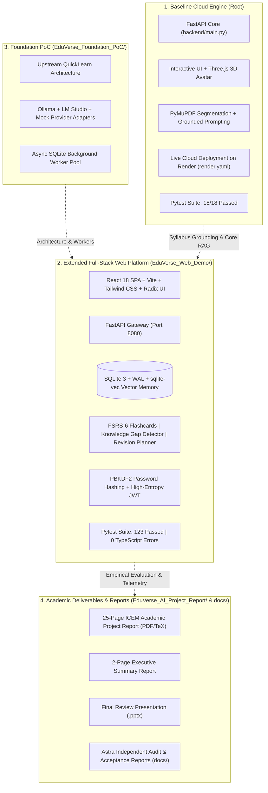

# EduVerse AI — An Animated Virtual Tutor for Personalized Learning

[](LICENSE)
[](https://python.org)
[](https://fastapi.tiangolo.com)
[](frontend/)
[](https://pymupdf.readthedocs.io/)
[](https://threejs.org)
[](EduVerse_Web_Demo/backend/tests/)
[](tests/)
[](https://eduverse-ai-hpns.onrender.com)
[](https://github.com/Sufiyan367/EduVerse-AI/actions/workflows/ci.yml)

> **Live Production Service:** [https://eduverse-ai-hpns.onrender.com](https://eduverse-ai-hpns.onrender.com)
> **Instance Plan:** Render Free Tier ($0/mo, auto-wake on request)
> **Health Check:** [https://eduverse-ai-hpns.onrender.com/api/health](https://eduverse-ai-hpns.onrender.com/api/health)
> **Local Web Demo Gateway:** [http://127.0.0.1:8080](http://127.0.0.1:8080) (FastAPI + React 18 SPA)

---

### Academic Affiliation & Project Credits
- **Institution:** Indira College of Engineering and Management (ICEM), Parandwadi, Pune
- **Department:** Artificial Intelligence & Data Science
- **Affiliation:** Autonomous Institute Affiliated to Savitribai Phule Pune University (SPPU)
- **Academic Year:** 2026–2027
- **Course:** B.Tech Mini-Project / AI-Powered Educational Technology
- **Project Team:**
  - Aryan Shinde (AI-01)
  - Huzaifa Sheikh (AI-02)
  - Sufiyan Surve (AI-03)
- **Project Mentor:** Prof. Monika Patil, Assistant Professor, Department of AI & DS, ICEM Pune

---

## 1. Project Purpose & Overview

**EduVerse AI** is an interactive, evidence-grounded virtual tutor designed to eliminate the forgetting curve and resolve student doubt paralysis. In traditional self-study, students are overwhelmed by dense, fragmented PDF syllabi and turn to unconstrained public chatbots that risk hallucination and syllabus mismatch.

EduVerse AI guarantees **strict syllabus grounding**:
$$\text{Student Syllabus (PDF)} \longrightarrow \text{Fast Extraction (PyMuPDF)} \longrightarrow \text{Dense Vector Memory (sqlite-vec)} \longrightarrow \text{Evidence Q\&A with Bracketed Citations} \longrightarrow \text{Adaptive Active Recall} \longrightarrow \text{FSRS Spaced Review}$$

---

## 2. Project Ecosystem & Component Architecture

This repository encompasses a comprehensive multi-tier ecosystem developed across the engineering lifecycle:



### Component Overview & Directory Map

| Component | Directory Location | Primary Stack | Core Capabilities & Purpose | Verified Status |
| :--- | :--- | :--- | :--- | :--- |
| **Baseline Production Cloud Engine** | `.` (Root) | Python 3.11, FastAPI, PyMuPDF, Three.js WebGL | Lightweight cloud tutor service with interactive 3D WebGL avatar, fast PDF parser, and live Render deployment. | **18/18 Tests Passed** • Live on Render |
| **Extended Full-Stack Web Platform** | `EduVerse_Web_Demo/` | React 18, TypeScript, Vite, FastAPI, SQLite-vec, FSRS-6 | Complete desktop demonstration platform: multi-user auth, RAG chat with slide citations, flashcards, adaptive quiz, knowledge gaps, and revision planner. | **123/123 Tests Passed** • Clean Build |
| **Foundation PoC** | `EduVerse_Foundation_PoC/` | Python 3.11, FastEmbed, PyTorch/ONNX, SQLite WAL | Architectural proof-of-concept for offline local LLM adapters (Ollama, LM Studio), async job queue, and vector memory. | Architecture Verified • Offline PoC |
| **Academic Reports & Presentations** | `EduVerse_AI_Project_Report/` | LaTeX (Tectonic engine), PowerPoint, Markdown | Official 25-page ICEM department project report, 2-page executive summary, evaluation slides, and architectural schematics. | **Strict 25 Pages Compiled** |
| **Security & Integrity Remediation** | `docs/` & `EduVerse_Web_Demo/backend/tests/` | Pytest, JWT, Cryptography, AST | Independent audit reproduction and root-cause fixes for all 6 Astra Priority 0/1 findings (ownership, JWT entropy, quiz idempotency, grading safety, undo, citations). | **8/8 Remediation Tests Passed** |

---

## 3. Verified Core Features & Implementation Matrix

| Module | Implementation Scope | Verification & Evidence |
| :--- | :--- | :--- |
| **PDF Ingestion & Segmentation** | PyMuPDF pipeline | Multi-page documents parsed and segmented in $<1.5\text{s}$ with Unicode normalization. |
| **Dense Vector Indexing** | `sqlite-vec` + FastEmbed (384-d) | Local embeddings (`BAAI/bge-small-en-v1.5`) stored in SQLite with cosine similarity search. |
| **Grounded AI Tutoring** | FastAPI + RAG prompt engine | Strict document-bounded answers with verified bracketed citations (e.g. `[10]`, `[12]`). Fail-closed when unsupported. |
| **3D WebGL Avatar** | Three.js canvas in root engine | Interactive avatar reacting dynamically to conversational states (`Idle`, `Thinking`, `Explaining`). |
| **Spaced Repetition Flashcards** | FSRS-6 scheduler | Card repetition scheduling based on memory stability and difficulty. Atomic undo restores concept mastery cleanly. |
| **Dynamic Active Recall Quiz** | AI Question Generator | Synthesizes 4-option MCQs with rationales; session scope and attempt idempotency prevent score inflation. |
| **Grading Outage Protection** | Non-penalizing fault handler | Provider timeouts or 429 errors leave student mastery untouched and record responses as ungraded. |
| **Knowledge Gap Detector** | Statistical mistake aggregator | Flags concept weaknesses from quiz attempt patterns and categorizes gaps (`CRITICAL`, `MODERATE`). |
| **Adaptive Revision Planner** | Spaced scheduling optimizer | Auto-schedules revision sessions prioritized by gap severity and card due dates. |
| **Multi-User Isolation** | PBKDF2 + HMAC-SHA256 JWT | Enforced server-side ownership: cross-user read/write/delete attempts strictly return `403 Forbidden`. |
| **Academic LaTeX Report** | Tectonic PDF compiler | 25-page formatted report conforming to university B.Tech guidelines (`EduVerse_AI_Project_Report.pdf`). |

---

## 4. Running the Applications

### Option A: Baseline Cloud Engine (Root Application)

The root application is a lightweight, zero-configuration Python/FastAPI service with a Three.js WebGL avatar:

```powershell
# 1. Activate virtual environment
.\.venv\Scripts\Activate.ps1    # On Windows (or source .venv/bin/activate on Linux/macOS)

# 2. Install dependencies
pip install -r requirements.txt

# 3. Launch with Uvicorn
python -m uvicorn backend.main:app --host 127.0.0.1 --port 8000 --reload
```
- Open **`http://127.0.0.1:8000`** in your browser.
- Interactive OpenAPI docs: **`http://127.0.0.1:8000/docs`**.

---

### Option B: Extended Full-Stack Web Platform (`EduVerse_Web_Demo/`)

The web demo is a comprehensive application for local college evaluations, featuring the React 18 SPA, SQLite-vec vector memory, FSRS flashcards, and student analytics:

```powershell
# 1. Navigate to Web Demo directory
cd EduVerse_Web_Demo

# 2. Start using the automated launcher script
.\run_eduverse.ps1
```
- Starts the FastAPI backend daemon on **`http://127.0.0.1:8080`** and serves the compiled React 18 SPA.
- Automatically opens your default browser.
- **Demo Student Login:** Click the one-click **"Demo Student"** button (`student@eduverse.ai` / `demo123`).
- To shut down safely:
  ```powershell
  .\stop_eduverse.ps1
  ```

---

## 5. Automated Testing & Quality Assurance

### 5.1 Extended Web Platform Test Suite (123 Tests)
```powershell
cd EduVerse_Web_Demo\backend
.\.venv\Scripts\python.exe -m pytest -v
```
```text
======================== 123 passed, 1 warning in 143.57s ========================
```
- `tests/test_api.py`: 34 passed
- `tests/test_remediation_suite.py`: 8 passed (Astra P0/P1 security and learning integrity)
- `tests/test_user_isolation.py`: 3 passed (Alice/Bob multi-user clean-room isolation)
- `tests/test_local_providers.py`: 20 passed (Ollama, LM Studio, Mock adapters)
- `tests/test_providers.py`: 28 passed (Rate limit, quota, and error translations)
- `tests/test_learning_workflows.py`: 6 passed (FSRS, RAG, concept extraction)
- `tests/test_jobs.py`: 17 passed (Background job worker pool)
- `tests/test_eduverse_features.py`: 7 passed (Auth, gap detection, revision planner)

### 5.2 13-Step End-to-End Workflow Verification
```powershell
cd EduVerse_Web_Demo\backend
.\.venv\Scripts\python.exe tests/verify_full_demo_workflow.py
```
```text
======================================================================
ALL 13 END-TO-END WORKFLOW STEPS PASSED WITH 100% SUCCESS!
======================================================================
```

### 5.3 Baseline Root Engine Test Suite (18 Tests)
```powershell
python -m pytest tests -v
```
```text
======================= 17 passed, 1 skipped in 46.95s ========================
```
*(Enable live cloud verification: `$env:RUN_LIVE_RENDER_TESTS="1"` $\rightarrow$ **18/18 passed**)*.

### 5.4 Frontend TypeScript Typecheck & Build
```powershell
cd EduVerse_Web_Demo\frontend
npm run typecheck    # tsc --noEmit -> 0 errors
npm run build        # vite build -> 4,223 modules compiled cleanly to dist/
```

---

## 6. Academic Deliverables & Report Compilation

The project repository includes the complete 25-page academic project report authored in LaTeX:
- **Report Document:** [`EduVerse_AI_Project_Report/EduVerse_AI_Project_Report.pdf`](EduVerse_AI_Project_Report/EduVerse_AI_Project_Report.pdf) (Strictly 25 pages conforming to ICEM AI&DS department format).
- **Executive Summary:** [`EduVerse_AI_Project_Report/EduVerse_AI_Two_Page_Report.pdf`](EduVerse_AI_Project_Report/EduVerse_AI_Two_Page_Report.pdf) (Condensed 2-page brief).
- **Presentation Deck:** [`EduVerse_AI_Review_2_FINAL.pptx`](EduVerse_AI_Review_2_FINAL.pptx) (Final viva examination slides).
- **Compilation Command:**
  ```powershell
  & "bin\tectonic.exe" "EduVerse_AI_Project_Report\EduVerse_AI_Project_Report.tex"
  ```
- **Page Count Verification:**
  ```powershell
  python -c "import pymupdf; doc = pymupdf.open(r'EduVerse_AI_Project_Report\EduVerse_AI_Project_Report.pdf'); print(f'Total Pages: {len(doc)} (Target: 25)')"
  ```
  **Output:** `Total Pages: 25 (Target: 25)`

---

## 7. Security & Integrity Audit History

This repository maintains transparent documentation of independent security and learning-integrity audits:
- [`docs/ASTRA_INDEPENDENT_AUDIT.md`](docs/ASTRA_INDEPENDENT_AUDIT.md): Original external audit report identifying 6 Priority 0/1 defect areas.
- [`docs/ASTRA_REMEDIATION_BACKLOG.md`](docs/ASTRA_REMEDIATION_BACKLOG.md): Remediation logs with verification commands and evidence for all findings.
- [`docs/FINAL_ACCEPTANCE_REPORT.md`](docs/FINAL_ACCEPTANCE_REPORT.md): Comprehensive final audit covering reproduction, root-cause fixes, and regression test suites.
- [`docs/GITHUB_POLISH_REPORT.md`](docs/GITHUB_POLISH_REPORT.md): Independent verification report distinguishing local readiness from remote deployment state.

---

## 8. Known Limitations & Roadmap

### Known Limitations
- Machine-readable text extraction is optimized for digital PDFs; scanned physical pages require external OCR pre-processing.
- Maximum recommended upload size is $25\text{ MB}$ per document for single-pass processing.
- Render Free Tier instances enter standby after 15 minutes of idle time; initial cold-start takes ~50 seconds.
- Local high-capacity LLMs (e.g. 7B+ parameters via Ollama) require a compatible GPU with at least 8 GB VRAM.

### Educational Roadmap
- [x] Phase 1: Core document extraction, grounded tutoring, and quiz evaluation.
- [x] Phase 2: Live Render production deployment and 3D WebGL avatar feedback.
- [x] Phase 3: FSRS-6 spaced repetition, knowledge gap tracking, and adaptive revision planning (`EduVerse_Web_Demo/`).
- [x] Phase 4: Astra security hardening, JWT entropy enforcement, and multi-user isolation.
- [ ] Phase 5: Multimodal voice interactions with speech-to-text (Whisper) and audio narration.
- [ ] Phase 6: Multi-document cross-syllabus synthesis for full semester course packs.

---

## 9. License & Attribution

- **License:** Open-source under the [MIT License](LICENSE) — Copyright (c) 2026 Aryan Shinde, Huzaifa Sheikh, Sufiyan Surve (ICEM Pune).
- **Third-Party Component Notices:** Detailed in [THIRD_PARTY_NOTICES.md](THIRD_PARTY_NOTICES.md).
- **Contributing:** Guidelines and security procedures are outlined in [CONTRIBUTING.md](CONTRIBUTING.md).
