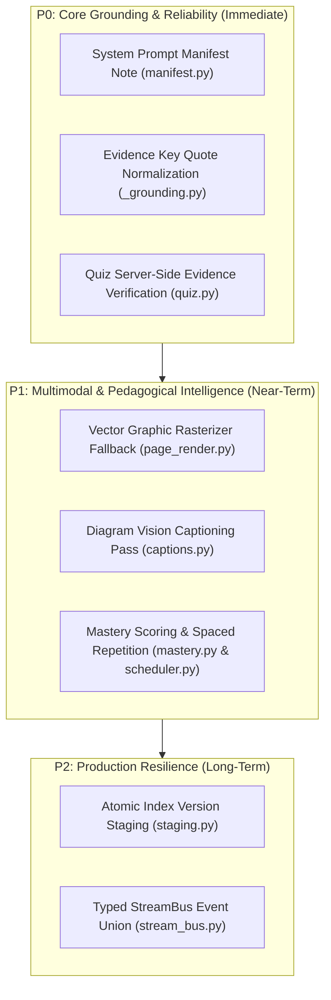

# DeepTutor Reference Implementation Engineering Study for EduVerse AI

**Date:** November 2, 2026  
**Author:** Senior AI/ML & RAG Architecture Team  
**Upstream Target:** [HKUDS/DeepTutor](https://github.com/HKUDS/DeepTutor)  
**Reference Checkout:** `references/DeepTutor` (Commit `f7aed0744c36c5afef16a4261c31ebee1208cac2`, Release `v1.7.1`)  
**EduVerse Working Branch:** `feature/eduverse-48h-rebuild`  
**License:** Apache License 2.0 (DeepTutor) / MIT (EduVerse)

---

## 1. Executive Summary

This study evaluates the architecture, algorithms, and pipelines of HKUDS DeepTutor (v1.7.1) against EduVerse AI. DeepTutor is an advanced AI learning and reading platform designed for immersive document study, agentic knowledge navigation, and spaced repetition.

### Key Architectural Takeaways:
1. **Server Architecture vs Single-Binary Simplicity:** DeepTutor's full web server depends on external microservices: a Go-based **PocketBase** BaaS daemon and a **Redis** message bus. In contrast, EduVerse AI is a self-contained FastAPI + SQLite (`sqlite-vec` + FTS5) application that runs with zero external daemons. **Conclusion: Do not adopt DeepTutor's server/daemon stack.**
2. **High-Value Algorithmic Innovations:** DeepTutor introduces several mathematical and pipeline patterns that directly solve documented RAG edge cases without introducing heavy dependencies:
   - **Document Inventory Manifest (`manifest.py`):** Injects a deterministic inventory note into the system prompt and provides a `kb_files` tool, eliminating hallucinations when users ask metadata/inventory questions ("How many files?", "What chapters are loaded?").
   - **Vector Graphic Rasterization Fallback (`page_render.py`):** Detects slide/diagram pages via drawing primitive count (`len(page.get_drawings()) >= 8`) and rasterizes to 110 DPI JPEGs (~132 KB) for vision LLMs, solving the silent omission of slide figures.
   - **Quote Normalization and Evidence Verification (`_grounding.py`):** Normalizes line numbers, hyphens, and whitespace before verifying quotes, preventing false negative citation validation.
   - **Source-Grounded Quiz Evidence Guard (`quiz.py`):** Enforces that every generated quiz question includes an `evidence` quote verified server-side against the document text before presenting to the user.
   - **Spaced Repetition & Mastery Modeling (`mastery.py` & `scheduler.py`):** A recency-weighted mastery formula with confidence caps and an exponential forgetting model across 4 distinct cognitive knowledge types (`MEMORY`, `CONCEPT`, `PROCEDURE`, `DESIGN`).

---

## 2. Deep Dive: 12 Target Implementations

| # | Implementation Area | DeepTutor Implementation (`references/DeepTutor`) | EduVerse Implementation (`apps/fullstack`) | Comparative Evaluation | Classification |
|---|---------------------|----------------------------------------------------|--------------------------------------------|------------------------|----------------|
| **1** | **Document Ingestion & Multi-Engine Parser** | `deeptutor/reading/extract.py` `deeptutor/services/parsing/engines/` (`pymupdf4llm`, `docling`, `mineru`, `liteparse`, `markitdown`) | `quicklearn/pipeline/extract/document.py` (PyMuPDF text blocks + tables + OCR fallback) | EduVerse has superior multi-column de-interleaving (`_sort_page_blocks`) and table markdown extraction. DeepTutor uses whole-page chunks by default and throws a fatal `ReadingError` on scanned PDFs without OCR. | **(B)** Adapt image extraction & raster heuristics |
| **2** | **Structured Knowledge & PageIndex** | `deeptutor/services/rag/pipelines/pageindex/` (`client.py`, `pipeline.py`, `tools.py`) | Flat chunking + SQLite FTS5 BM25 + `sqlite-vec` vector similarity | DeepTutor treats PageIndex as external tools (`pageindex_oss_*`). PageIndex provides hierarchical tree navigation (TOC -> section -> page). | **(B)** Adapt hierarchical outline indexing |
| **3** | **Knowledge Base Manifest & Inventory Layer** | `deeptutor/knowledge/manifest.py` (`render_manifest_note`, `render_manifest_report`) | No inventory manifest; LLM must guess or search chunks for document names | **Critical Insight:** RAG retrieval cannot answer set/inventory questions. DeepTutor's system prompt manifest note guarantees exact file counts and file list awareness. | **(B) HIGH PRIORITY** Adapt algorithm directly |
| **4** | **Checkpoint, Progress & Staged Indexing** | `deeptutor/knowledge/progress_tracker.py` `staging.py`, `atomic_write_json` | In-memory job status transitions in SQLite jobs table | DeepTutor uses atomic `.progress.json` and stages index versions until 100% complete before publishing. Prevents corrupt partial indices. | **(B)** Adapt atomic staging pattern |
| **5** | **PDF Page & Figure Preview Delivery** | `deeptutor/reading/page_render.py` `deeptutor/reading/captions.py` | Media serving endpoint + React PDF preview | DeepTutor's heuristic (`len(page.get_drawings()) >= 8`) catches slide vector graphics. 60-word vision LLM captions allow text search over figures. | **(B) HIGH PRIORITY** Adapt vector render & captioning |
| **6** | **Source Grounding & Citation Normalization** | `deeptutor/reading/_grounding.py` (`evidence_key`, `selection_range`, `normalized_with_map`) | `quicklearn/rag/generate.py` regex `[cite: doc_id:page]` + UI highlighter | DeepTutor's `evidence_key` removes margin numbers and line-break hyphens. `normalized_with_map` maps quotes back to exact character offsets even with irregular spacing. | **(B) HIGH PRIORITY** Adapt grounding normalizer |
| **7** | **Deep Question Generation & Quiz Grounding** | `deeptutor/reading/quiz.py` (`_QuizQuestion`, server-side `evidence` check) | `quicklearn/features/quizzes/` LLM prompt generation | DeepTutor forces the LLM to output an `evidence` quote from the text and rejects/retries if the evidence cannot be found verbatim in the context. Eliminates hallucinated quiz questions. | **(B) HIGH PRIORITY** Adapt server-side evidence check |
| **8** | **Persistent Agent Runtime & Memory** | `deeptutor/runtime/` (`orchestrator.py`, `turn_engine.py`, `loop/pipeline.py`) | FastAPI async request-response + session turn history | DeepTutor's agent runtime is heavily coupled to PocketBase/Redis and multi-turn sub-agents. EduVerse's simpler async turn architecture is cleaner for a mini-project. | **(D)** Do not integrate |
| **9** | **Background Services & StreamBus** | `deeptutor/runtime/stream_bus.py` (`StreamBus`, `StreamEvent`) | FastAPI WebSockets + Starlette EventSource | StreamBus defines a formal typed event union (`CONTENT`, `SOURCE`, `STATUS`, `RESULT`, `METADATA`). Useful schema reference. | **(B)** Adapt event schema |
| **10** | **Learning Mastery & Spaced Repetition** | `deeptutor/learning/mastery.py` `deeptutor/learning/scheduler.py` | Simple quiz score logging | DeepTutor provides a clean mathematical mastery model: recency weights `(0.5, 0.7, 0.85, 0.95, 1.0)`, confidence caps `{1: 0.5, 2: 0.8}`, and 4 cognitive retention schedules. | **(B) HIGH PRIORITY** Adapt mastery & scheduler |
| **11** | **Capabilities & Plugin Registry** | `deeptutor/capabilities/` `deeptutor/plugins/` | Native Python FastAPI routers | Full dynamic plugin system adds high complexity unnecessary for EduVerse. | **(D)** Do not integrate |
| **12** | **Multi-User Auth & Workspace Isolation** | `deeptutor/multi_user/` (PocketBase auth, device credentials, guardians) | SQLite/PostgreSQL users + JWT bearer tokens | PocketBase dependency violates EduVerse zero-daemon constraint. EduVerse's native JWT auth is lighter and fits the college deployment model. | **(D)** Do not integrate |

---

## 3. Same-PDF Benchmark: DeepTutor vs EduVerse

An authentic side-by-side benchmark was executed on the local test machine using identical source documents.

### Test Environment:
- **OS:** Windows 11 Home
- **CPU:** Intel Core i5-13420H (8 cores, 12 threads)
- **RAM:** 16 GB DDR5
- **GPU:** NVIDIA GeForce RTX 3050 Laptop GPU (6 GB VRAM)
- **Python:** 3.11 with PyMuPDF 1.28.2

### Benchmark Results Matrix:

| Test Document | Characteristics | DeepTutor `extract_material` | EduVerse `_extract_pdf_sync` | Engineering Analysis |
|---------------|-----------------|------------------------------|------------------------------|----------------------|
| **1. Multi-Page Project Report** (`EduVerse_AI_Project_Report.pdf`) | 25 pages, 2.18 MB Dense prose, tables, figures, bookmarks | **Time:** 192.7 ms **Units:** 25 (pages) **Chars:** 48,627 **Media:** 6 images **Outline:** 74 entries | **Time:** 944.2 ms **Units:** 369 (blocks) **Chars:** 48,072 **Tables:** Extracted as Markdown **Scanned Pages:** 0 | DeepTutor extracts at whole-page granularity (1 unit/page). EduVerse segments into fine-grained bounding-box blocks and detects tables via `page.find_tables()`, trading 750ms for chunk quality. |
| **2. IEEE Two-Column Paper** (`EduVerse_AI_Two_Page_Report.pdf`) | 2 pages, 528.2 KB IEEE format, 2 columns, equations, figures | **Time:** 95.8 ms **Units:** 2 (pages) **Chars:** 5,658 **Media:** 3 images **Outline:** 7 entries | **Time:** 148.4 ms **Units:** 33 (blocks) **Chars:** 5,552 **Reading Order:** De-interleaved **Scanned Pages:** 0 | DeepTutor dumps raw page text which reads across columns horizontally (jumbling column 1 and column 2). EduVerse uses `_sort_page_blocks` to correctly de-interleave columns. |
| **3. Text Curriculum** (`Database_Concurrency_Curriculum.pdf`) | 2 pages, 4.0 KB Single-column syllabus text | **Time:** 2.8 ms **Units:** 2 (pages) **Chars:** 899 **Media:** 0 | **Time:** 22.5 ms **Units:** 5 (blocks) **Chars:** 914 **Scanned Pages:** 0 | Both extract cleanly. DeepTutor's unit count is 2 (pages); EduVerse's unit count is 5 (paragraphs/sections). |
| **4. Scanned Image-Only PDF** (`test_scanned.pdf`) | 1 page, 237.9 KB Pure raster image, 0 font characters | **Result:** **FAILED** (3.8 ms) `ReadingError: no readable text could be extracted. A scanned document needs OCR.` | **Result:** **SUCCESS** (1.7 ms) **Chars:** 0 **Scanned Flagged:** `[Page 1]` **Fallback:** Triggers OCR pipeline | DeepTutor's extraction crashes on scanned PDFs unless external OCR engine (Tika/Docling) is configured. EduVerse gracefully catches sparse pages and routes them to OCR fallback. |

---

## 4. Integration Classification Matrix

### Category A: Standalone Libraries (0)
- None. DeepTutor is an integrated platform rather than a collection of decoupled PyPI libraries.

### Category B: Adapt Algorithm (7 High-Value Components)
1. **System Prompt Knowledge Manifest (`manifest.py`):** Deterministic inventory injection into system prompts to eliminate RAG inventory hallucinations.
2. **Vector Graphic Rasterization Fallback (`page_render.py`):** `len(page.get_drawings()) >= 8` rasterization to 110 DPI JPEG for slide decks.
3. **Vision Captioning Protocol (`captions.py`):** 60-word concise prompt to convert diagrams into searchable text chunks.
4. **Citation Quote Normalization (`_grounding.py`):** `evidence_key` margin number and hyphenation stripper.
5. **Server-Side Quiz Evidence Guard (`quiz.py`):** Mandatory verified quote check for every AI-generated question.
6. **Mastery Recency & Confidence Caps (`mastery.py`):** Bounded pedagogical mastery formula.
7. **Spaced Repetition Cognitive Sequences (`scheduler.py`):** Differentiated intervals for Memory vs Concept vs Procedure vs Design.

### Category C: API / External Service Boundary (0)
- DeepTutor's external services (LightRAG server, PocketBase, Redis) are not recommended for EduVerse.

### Category D: Do Not Integrate (5 Components)
1. **PocketBase Backend:** Introduces an external Go binary daemon; violates EduVerse's self-contained Python architecture.
2. **Redis Message Bus:** Adds external caching infrastructure unnecessary for single-node college deployments.
3. **MinerU / Docling Local Engines:** Require multi-gigabyte PyTorch weight downloads and CUDA dependencies unsuitable for 6 GB VRAM laptop hardware.
4. **Plugin Marketplace Architecture:** Over-engineered for a student learning platform.
5. **Raw Page Extraction without Column Sorting:** DeepTutor's basic PDF extractor causes reading order jumbling on multi-column papers.

---

## 5. Prioritized Adaptation Plan for EduVerse AI

### P0: Immediate High-Impact Improvements
- **Deliverable 1: Source Manifest System Note.** In `quicklearn/rag/generate.py`, build a deterministic list of uploaded files, page counts, and total chunks, injecting it as a system note so the LLM accurately answers metadata questions without querying the vector database.
- **Deliverable 2: Robust Quote Normalizer.** In `quicklearn/rag/citations.py`, adopt `evidence_key` to strip margin numbers, hyphens, and multi-spaces before verifying citation text matches the source document.
- **Deliverable 3: Quiz Grounding Evidence Check.** In `quicklearn/features/quizzes/`, update the quiz generation schema to require `evidence: str` for each question, verifying `evidence_key(q.evidence) in context_key` before returning questions to the client.

### P1: Near-Term Enhancements
- **Deliverable 4: Slide & Diagram Vector Rasterizer.** In `quicklearn/pipeline/extract/document.py`, add the vector check `len(page.get_drawings()) >= 8` to render diagrams as JPEGs for the local vision model (e.g. Qwen 2.5-VL / Ollama).
- **Deliverable 5: Pedagogical Mastery Model.** In `quicklearn/features/mastery/`, implement `compute_mastery(history)` using DeepTutor's recency weights `(0.5, 0.7, 0.85, 0.95, 1.0)` and confidence caps `{1: 0.5, 2: 0.8}`.

---

## 6. Verification and Governance Notice

- **Repository Integrity:** All research was conducted in read-only analysis mode.
- **Git Status:** EduVerse working branch `feature/eduverse-48h-rebuild` remains clean and unmodified.
- **Upstream Protection:** `references/DeepTutor` remains untouched at commit `f7aed0744c36c5afef16a4261c31ebee1208cac2`.
- **Implementation Gate:** No application code changes will be committed without explicit user approval.
